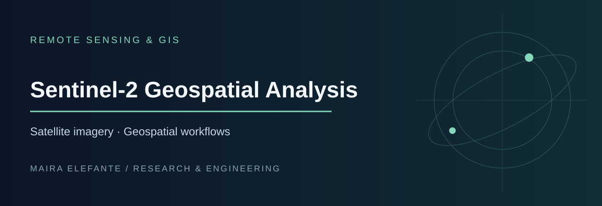

> **Satellite imagery · Geospatial workflows**

**Area:** Remote Sensing & GIS · [Browse project files](./)

---

# Sentinel-2 Geospatial Analysis Pipeline

A Python geospatial and remote-sensing pipeline for processing Sentinel-2 Level-2A multispectral satellite imagery and deriving vegetation information over a defined geographic area of interest.

The project uses real Copernicus Sentinel-2 data over Rome, Italy, and demonstrates raster processing, coordinate reference system handling, spatial clipping, NDVI computation, validation, statistical analysis, and geospatial output generation.

## Project Overview

The objective of this project is to build a reproducible workflow that transforms raw multispectral satellite observations into interpretable geospatial vegetation metrics.

The pipeline uses Sentinel-2 Level-2A imagery acquired on 13 July 2026 over the Rome area.

Two 10 m spatial-resolution bands are used:

- B04 — Red
- B08 — Near Infrared (NIR)

Vegetation is analysed using the Normalized Difference Vegetation Index:

```text
NDVI = (NIR - Red) / (NIR + Red)
```

NDVI typically ranges from -1 to +1. Higher positive values generally indicate stronger vegetation signals, while low or negative values can correspond to non-vegetated surfaces, water, or other land-cover types.

## Processing Workflow

The pipeline follows the workflow:

```text
Sentinel-2 Level-2A imagery
        |
        v
B04 (Red) + B08 (Near Infrared)
        |
        v
Raster metadata and grid validation
        |
        v
AOI definition
        |
        v
CRS reprojection
        |
        v
Raster clipping
        |
        v
NDVI computation
        |
        v
Pixel validation
        |
        v
Statistical analysis
        |
        +-------------------+
        |                   |
        v                   v
GeoTIFF output        PNG visualization
        |
        v
JSON statistics
```

## Dataset

The analysis uses Copernicus Sentinel-2 Level-2A imagery.

**Acquisition date:** 13 July 2026  
**Tile:** T33TTG  
**Product type:** Sentinel-2 MSI Level-2A  
**Red band:** B04  
**Near-infrared band:** B08  
**Spatial resolution:** 10 m  
**Raster CRS:** EPSG:32633 (WGS 84 / UTM zone 33N)

The raw satellite imagery is intentionally excluded from the Git repository because the original raster files are large and can be obtained independently from the Copernicus Data Space Ecosystem.

## Area of Interest

The study area is a defined region around Rome, Italy.

The AOI is stored as a GeoJSON vector geometry in EPSG:4326.

Before raster clipping, the pipeline automatically reprojects the AOI into the Sentinel-2 raster coordinate reference system.

The resulting clipped raster has:

```text
Width:       3445 pixels
Height:      3773 pixels
Resolution:  10 m x 10 m
CRS:         EPSG:32633
```

This spatial clipping prevents statistics from being calculated over the complete Sentinel-2 tile, which includes large areas outside the intended study region.

## Results

The Rome AOI analysis produced:

| Metric | Result |
|---|---:|
| Valid pixels | 12,420,451 |
| Mean NDVI | 0.2414 |
| Median NDVI | 0.2055 |
| Maximum NDVI | 0.7674 |
| Minimum NDVI | -0.6962 |
| Standard deviation | 0.1475 |
| Fraction with NDVI > 0.3 | 30.15% |

The analysis demonstrates substantial spatial variation in vegetation signal across the study region.

Clipping the imagery to the study area also materially changed the aggregate statistics compared with analysing the complete Sentinel-2 tile, demonstrating why spatial extent must be controlled when interpreting raster-derived statistics.

## Outputs

The processing workflow generates three principal outputs:

```text
outputs/rome/
├── ndvi.tif
├── ndvi_map.png
└── ndvi_statistics.json
```

### `ndvi.tif`

Georeferenced floating-point GeoTIFF containing the calculated NDVI values.

### `ndvi_map.png`

Visual representation of the spatial NDVI distribution.

### `ndvi_statistics.json`

Machine-readable summary statistics derived from valid pixels in the analysis.

## Project Structure

```text
sentinel2-geospatial-analysis/
│
├── data/
│   ├── raw/
│   │   ├── B04 Sentinel-2 imagery
│   │   └── B08 Sentinel-2 imagery
│   │
│   ├── processed/
│   │   ├── rome_B04_10m.tif
│   │   └── rome_B08_10m.tif
│   │
│   └── aoi/
│       └── rome_aoi.geojson
│
├── src/
│   ├── __init__.py
│   ├── main.py
│   ├── ndvi.py
│   ├── raster_processing.py
│   └── validation.py
│
├── tests/
│   └── test_ndvi.py
│
├── outputs/
│   └── rome/
│       ├── ndvi.tif
│       ├── ndvi_map.png
│       └── ndvi_statistics.json
│
├── docs/
│
├── requirements.txt
├── .gitignore
├── LICENSE
└── README.md
```

## Geospatial Processing

The project uses Rasterio, GeoPandas, Shapely, NumPy, and related Python geospatial libraries.

The raster-processing workflow includes:

- reading georeferenced satellite rasters;
- inspecting raster CRS, resolution, transform, and dimensions;
- reprojecting vector AOIs between coordinate reference systems;
- clipping raster imagery using vector geometries;
- maintaining geospatial metadata in generated products;
- aligning raster grids where required;
- calculating pixel-level spectral indices;
- exporting floating-point GeoTIFF products.

## Validation

Automated tests are included for the NDVI calculation.

Run:

```bash
python -m pytest -q
```

Expected result:

```text
2 passed
```

The workflow also includes validation of raster properties such as CRS, spatial resolution, raster dimensions, valid pixel counts, and output value ranges.

## Example Usage

After installing the dependencies:

```bash
pip install -r requirements.txt
```

the NDVI pipeline can be executed with:

```bash
python -m src.main \
    --red data/processed/rome_B04_10m.tif \
    --nir data/processed/rome_B08_10m.tif \
    --output outputs/rome
```

On Windows PowerShell:

```powershell
python -m src.main --red "data\processed\rome_B04_10m.tif" --nir "data\processed\rome_B08_10m.tif" --output "outputs\rome"
```

## Debugging and Engineering Validation

During development, an output-format issue was identified when raster metadata inherited the JPEG2000 driver from the original Sentinel-2 input.

The pipeline initially attempted to write floating-point NDVI values using the inherited JP2 driver. Rasterio/GDAL rejected the operation because the selected JPEG2000 driver did not support the required floating-point output type.

The issue was diagnosed by tracing the raster output profile.

The solution was to explicitly write NDVI products as:

```text
Driver: GeoTIFF
Data type: float32
Compression: DEFLATE
```

The corrected pipeline was rerun and validated successfully.

This illustrates an important principle used throughout the project: generated code and geospatial assumptions are validated against actual raster metadata and runtime behaviour rather than accepted without verification.

## AI-Assisted Development Workflow

AI coding assistance was used during implementation and debugging as part of a multi-step engineering workflow rather than solely as a conversational interface.

The workflow included:

```text
Task specification
        ↓
AI-assisted implementation
        ↓
Execution on real geospatial data
        ↓
Runtime / geospatial validation
        ↓
Failure identification
        ↓
Human diagnosis
        ↓
Code correction
        ↓
Automated testing
        ↓
Real-data re-execution
```

A concrete example was the JP2 output-driver failure. The generated implementation was not assumed to be correct: it was executed against real Sentinel-2 data, the GDAL/Rasterio error was analysed, the raster profile was corrected, and the pipeline was rerun successfully.

## Technologies

Python  
NumPy  
Rasterio  
GeoPandas  
Shapely  
PyProj  
Matplotlib  
Pytest  
Sentinel-2  
Copernicus Data Space Ecosystem  
GeoTIFF  
GeoJSON  
Remote Sensing  
GIS  
Spatial Analytics

## Limitations and Future Improvements

The current project focuses on Red/NIR vegetation analysis over a defined AOI.

Potential extensions include:

- Sentinel-2 Scene Classification Layer integration;
- explicit cloud and cloud-shadow masking;
- automated Copernicus data acquisition;
- multi-date NDVI analysis;
- vegetation-change detection;
- additional spectral indices such as NDWI and NDSI;
- land-cover segmentation;
- temporal anomaly detection.

## License

MIT License.